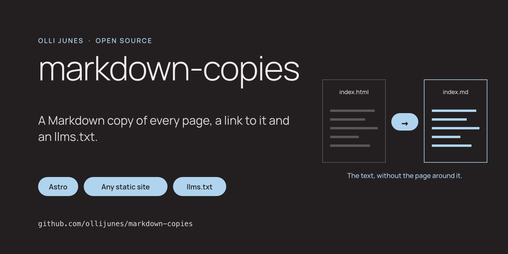

# markdown-copies



[](https://github.com/ollijunes/markdown-copies/actions/workflows/ci.yml)
[](package.json)
[](LICENSE)

Give every article on a static site a Markdown copy at a fixed address, link
to it from the page, and list the copies in `llms.txt`. An Astro integration
and a command line tool for any build folder.

An AI agent that reads your article gets the HTML: navigation, cookie
banner, footer and scripts around the text. It has to guess where the
article starts. A Markdown copy is the text and nothing else, at an address
the agent can find and a person can link to.

markdown-copies runs after your build. For each page it writes
`index.md` next to `index.html`, adds a `<link rel="alternate"
type="text/markdown">` to the head and a visible link at the end of the
article, and builds `llms.txt` from the pages it copied. A new article needs
no extra work.

[Security](SECURITY.md) · [Contributing](CONTRIBUTING.md) ·
[ollijunes.com](https://ollijunes.com)

## Who it is for

People who publish articles, guides or documentation as a static site
(Astro, Eleventy, Hugo, hand-written HTML) and want agents and language
models to read the text, not the page around it.

## With Astro

```sh
npm install github:ollijunes/markdown-copies
```

```js
// astro.config.mjs
import { defineConfig } from 'astro/config';
import markdownCopies from 'markdown-copies/astro';

export default defineConfig({
  site: 'https://example.com',
  integrations: [markdownCopies({ include: ['/blog/**'] })],
});
```

```text
$ astro build
[markdown-copies] 2 Markdown copies, llms.txt
```

`site` must be set, because the copies use absolute addresses. `base` is
honoured.

## With any other site

Build the site, then point the command at the output folder.

```sh
npx github:ollijunes/markdown-copies dist --site https://example.com --include '/blog/**'
```

```text
wrote blog/rye/index.md
wrote fi/blogi/ruis/index.md
wrote llms.txt (2 pages)
```

`--dry-run` lists what would be written and changes nothing.

## What you get

For `https://example.com/blog/rye/`:

**1. A copy** at `https://example.com/blog/rye/index.md`:

```markdown
---
title: "How to bake rye bread"
url: "https://example.com/blog/rye/"
description: "A plain recipe."
language: "en"
date: "2026-10-28"
alternate_fi: "https://example.com/fi/blogi/ruis/index.md"
index: "https://example.com/llms.txt"
generator: "markdown-copies"
---

# How to bake rye bread

28 Oct 2026

Mix [rye flour](https://example.com/flour/) and water.

- Starter
- Dough
```

Links and images are absolute. Navigation, footers, forms and buttons are
left out. `url` is the page's canonical address, so nobody mistakes the
copy for the original. A translation named with `hreflang` is linked as its
own Markdown copy when it has one.

**2. A link in the head**, where programs look:

```html
<link rel="alternate" type="text/markdown" href="https://example.com/blog/rye/index.md">
```

**3. A visible link** at the end of the article, where people and agents
that read the rendered page find it:

```html
<p class="markdown-copy"><a href="/blog/rye/index.md" type="text/markdown">This page as a Markdown file</a></p>
```

The text is in English or Finnish by the page's `lang`, and you can set your
own. Style it with the `markdown-copy` class. The copy itself does not
contain this link.

**4. `llms.txt`**, in the [llmstxt.org](https://llmstxt.org) format. Your own
`llms.txt` (for example `public/llms.txt` in Astro) is kept as the start of
the file. The lists are added after it, by language, newest first:

```markdown
# Example

> A bakery blog.

<!-- markdown-copies: the lists below are generated -->

## Articles (English)

- [How to bake rye bread](https://example.com/blog/rye/index.md): 2026-10-28. A plain recipe.

## Artikkelit (suomeksi)

- [Ruisleipä](https://example.com/fi/blogi/ruis/index.md): Ohje.
```

**5. A line in `robots.txt`**, if the file exists: `# LLMs:
https://example.com/llms.txt`.

A page served without a trailing slash (`blog/rye.html`) gets `blog/rye.md`,
the same address plus `.md`.

## Which pages

`include` and `exclude` are globs on the URL path. `*` stays inside one
segment, `**` crosses segments. A page is skipped when it has a `noindex`
robots meta tag, is a redirect page, names another page in its canonical
link, or has no `<article>` or `<main>` element. A Markdown file without the
`generator: "markdown-copies"` line is yours, and it is never overwritten.

The date comes from `article:published_time`, then the first `<time
datetime>` in the article, then `datePublished` in JSON-LD. The title is the
article's `<h1>`, then `og:title`, then `<title>`.

## Options

The integration and the JavaScript API take the same options. The command
line has a flag for each; see `markdown-copies --help`.

| Option | Default | Meaning |
| --- | --- | --- |
| `site` | Astro's `site` | The site's address. Required |
| `base` | Astro's `base`, `/` | Path the site is served under |
| `include` | `['/**']` | Pages that get a copy |
| `exclude` | `['/404', '/404/**']` | Pages that do not |
| `content` | `['article', 'main']` | Selectors for the element that holds the text. The first that matches wins |
| `remove` | `nav`, `footer`, `aside`, `form`, `button`, `script`, `style`, `noscript`, `iframe` | Elements left out of the copy |
| `link` | `true` | Add the visible link |
| `linkText` | English and Finnish | Text by language, for example `{ sv: 'Den här sidan som Markdown' }` |
| `linkBefore` | end of the content element | Selector of an element to put the visible link before, for example an author box |
| `llms` | `true` | Write `llms.txt` |
| `llmsHeader` | the existing `llms.txt` | A file with the hand-written start of `llms.txt` |
| `llmsHeadings` | English and Finnish | Section headings by language |
| `robots` | `true` | Mention `llms.txt` in `robots.txt` |
| `dryRun` | `false` | Change nothing |

```js
import { markdownCopies } from 'markdown-copies';

const result = await markdownCopies({ dir: 'dist', site: 'https://example.com' });
// { pages: [...], skipped: [{ file, reason }], llmsFile: 'llms.txt' }
```

## Check the result on your host

```sh
curl -s -o /dev/null -w '%{http_code} %{content_type}\n' https://example.com/blog/rye/index.md
```

You want `200 text/markdown; charset=utf-8`. Most static hosts send that.
If yours sends `application/octet-stream`, the file downloads in a browser
and some agents skip it: add a rule for `.md` to the server config. Some
setups block `*.md` on purpose, because repository notes sit in the web
root. Allow the article paths there.

## Limitations

- It reads built HTML, so only pages that exist as files get a copy. Pages
  rendered on request (SSR) do not.
- The conversion is as good as the page's HTML. Text drawn by JavaScript,
  tabs that load on click and content inside images are not in the copy.
- It edits the built HTML with two insertions and changes nothing else. It
  does not run in `astro dev`.
- Nobody has shown that a Markdown copy or an `llms.txt` improves how a
  site ranks or how often a model cites it, and Google has said its Search
  does not use `llms.txt`. The copies make the text easier to fetch and to
  link to; that is the whole claim.
- The copies are not added to the sitemap, on purpose. The front matter's
  `url` names the original.
- Link text and `llms.txt` headings are built in for English and Finnish
  only. Set your own for other languages.

## How it compares

Cloudflare's "Markdown for Agents" converts a page when the request asks
for `text/markdown`. That needs Cloudflare in front of the site and gives
no address of its own to link to. Several `llms.txt` generators for Astro
write the index only, or one large file with everything. markdown-copies
writes one file per page next to the page, links both ways and works on any
folder of HTML.

## Development

```sh
npm ci
npm test
npm run coverage
npm run lint
python3 scripts/check_public_tree.py
```

The tests build small sites in a temporary folder. `examples/` has an Astro
config to copy from.

## License

[MIT](LICENSE). Made by [Olli Junes](https://ollijunes.com). Powered by [ResaHost](https://resahost.net/en/). Not affiliated
with Astro or Cloudflare.
